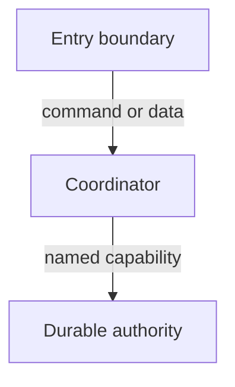
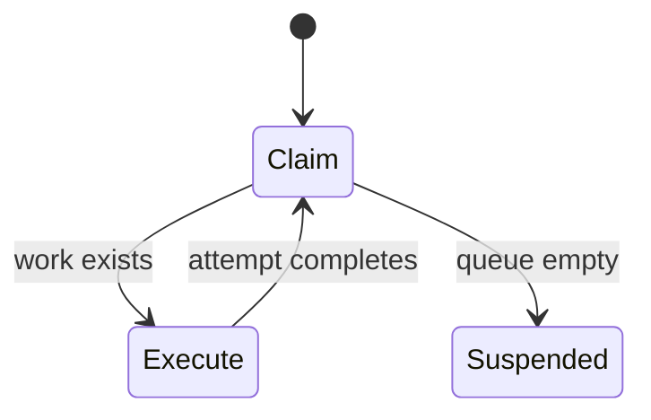
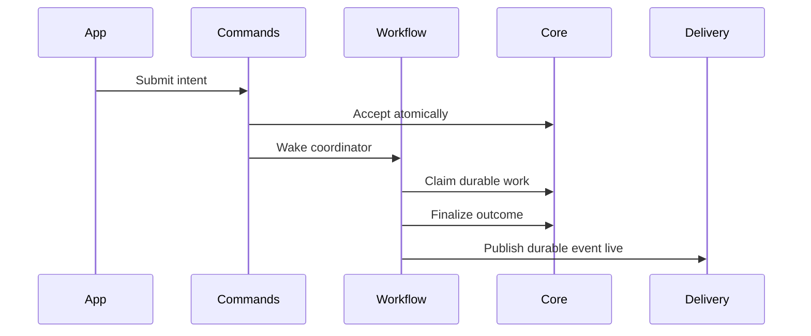

# Architecture Explainer Presentation Template

Use this as a flexible composition guide, not a mandatory report form. Remove sections that do not improve the explanation.

## Opening

````markdown
# [Scope] Map

**Thesis:** [One sentence naming the primary ownership or dependency rule.]


````

The thesis should let readers predict where behavior belongs before they learn filenames.

## Responsibility Inventory

Use for packages, layers, or feature directories:

```markdown
## Directory Responsibilities

| Directory | Purpose | Useful shorthand |
|---|---|---|
| `commands/` | Translate caller intent into capabilities | **Command boundary** |
| `workflow/` | Coordinate durable work over time | **Process manager** |
| `delivery/` | Reconcile durable history with live transport | **Delivery bridge** |
```

Choose shorthand that is memorable and accurate, not merely clever.

## Major Area Section

Use this shape for each important area:

````markdown
## `workflow/`: Durable Process Manager

[Two or three sentences explaining its role in the larger system.]



It:

1. [First important action.]
2. [Second action.]
3. [Third action.]

See `path/to/file.ts:20-80`.

### It owns

- [Canonical responsibility]
- [Sequencing or policy responsibility]

### It does not own

- [Neighboring responsibility]
- [Durable or product authority owned elsewhere]

> Think: **“[Short operational mental model.]”**
````

Do not force every subsection when a paragraph and citation are enough.

## End-to-End Flow

Use a sequence diagram when order, durability, retries, or publication matters:

````markdown
## End-to-End Lifecycle


````

Explain ordering invariants immediately after the diagram, for example:

> **Persist first, publish second.** Live delivery can fail without losing reconnect truth.

## Contrast Table

Use when names or responsibilities are easy to confuse:

```markdown
## Distinguishing Similar Areas

| `workflow/` | `runtime-execution/` |
|---|---|
| Coordinates the actual durable process | Wraps the ordinary path for batch callers |
| Long-lived and keyed by aggregate | Request-oriented and waits for evidence |
```

## Placement Rule

Turn the map into a decision rule:

```markdown
## Where New Behavior Belongs

Ask: **Does this decide what state is valid, or when a valid operation runs?**

- Durable validity or canonical meaning belongs in Core.
- Timing, retries, and recovery belong in Runtime.
- Product-specific choices belong at the application policy boundary.
```

Use repository-specific terms rather than generic layer names.

## Closing Sections

For broad explanations, close with:

```markdown
## Shortest Useful Summary

> **Commands accept intent; Workflow coordinates durable work; Execution performs it; Delivery reconciles history with live transport.**

## Recommended Reading Order

1. `docs/language.md`
2. `src/commands/submit.ts`
3. `src/workflow/program.ts`
4. `src/execution/activity.ts`
5. `src/delivery/subscription.ts`

## Architectural Consequences

- [What the dependency direction prevents.]
- [What callers may safely assume.]
- [Where a future change belongs.]

## Confidence and Gaps

[State confidence, proposed or stale documents, inferred relationships, missing callers, and unsearched boundaries.]
```

## Citation Style

- Cite direct evidence near the claim: `packages/example/src/service.ts:42-91`.
- Cite several files only when each proves a different leg of the relationship.
- Avoid citations in Mermaid node labels.
- Use repository-relative paths.
- If exact lines are unavailable, cite the file and say what was verified there.

## Adaptation Rules

- For two-package ownership questions, emphasize dependency direction, canonical contracts, and placement rules.
- For directory inventories, emphasize the responsibility table, per-directory mental models, and one lifecycle diagram.
- For request-flow questions, emphasize a sequence diagram, side effects, failure boundaries, and ordering invariants.
- For unclear architecture, present a partial map with direct evidence first and ambiguities afterward.
- For small scopes, omit broad closing sections and answer compactly.
