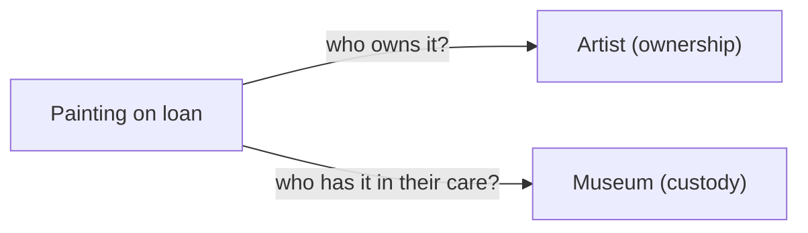
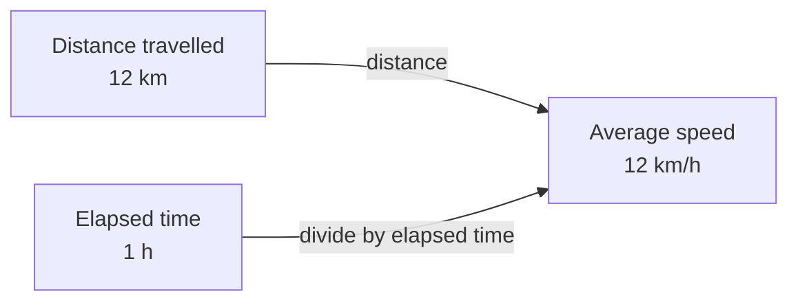

# Mermaid diagrams in chat answers

Choose the diagram that answers the question. Introduce it with the takeaway, and explain the example in words so the answer still works when Mermaid isn't rendered.

| Reader needs to see… | Use |
|---|---|
| Parts of a concept, a comparison, or a decision | A `flowchart` with labelled relationships or conditions. An arrow can mean “belongs to”; it needn't be a step in time. |
| A handoff between people or groups | A `sequenceDiagram` naming the participants and what passes between them. |
| A lifecycle | A `stateDiagram-v2` naming the states and the event that triggers each transition. |
| How a quantity is derived | A `flowchart` with values and units on nodes and operations on edges. Use `subgraph`s for phases if needed. |
| A pattern over time | An `xychart-beta` with labelled axes. Name the series in prose and include the values in a small table for renderers without chart support. |

## Example: a relationship, not a sequence

In this illustrative museum loan, the artist still owns the painting while the museum has it in its care. The two terms answer different questions about the same object.

If the museum returns the painting, custody changes again. Returning it doesn't change who owns it.

## Example: a calculation

Average speed uses the whole trip's distance and elapsed time, including stops. For an illustrative 12 km trip that takes one hour door to door:

Check the relationship as well as the arithmetic: a longer stop on the same trip increases elapsed time without changing distance, so the average speed falls.

## Rendering notes

- Prefer one small diagram. If labels need paragraphs, move the detail into prose. Use consistent names; encode meaning in words before adding colour.
- In flowcharts, use simple alphanumeric IDs, quote node and edge labels, and put each edge on its own line. Avoid reserved IDs such as `end`. Use ` ` for a needed line break.
- Show independent branches separately. Don't connect two ideas just because the explanation mentions them consecutively.
- If `mmdc` is available, validate the diagram locally in a scratch directory (`mmdc -i diagram.mmd -o diagram.svg`). Otherwise check syntax by inspection; don't install a renderer to answer in chat.
